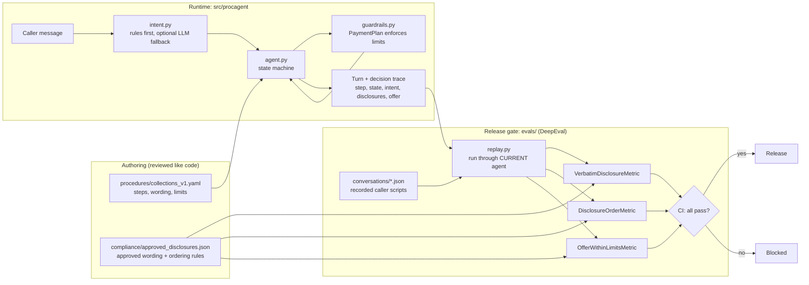

# procedure-agent

[](https://github.com/sampro14/procedure-agent/actions/workflows/eval-gate.yml)


A small chat agent that follows a **written procedure**, plus a **replay-based eval gate** (DeepEval) that checks every legally required disclosure **word for word** before a change can ship.

The scenario is a fictional debt-collection call. The point is the engineering pattern for regulated conversations: *the procedure is data, the wording is verbatim, the limits are enforced in code, and nothing ships unless the replay suite passes.*

## At a glance

- **Verbatim disclosures:** legal wording is copied from the procedure, never generated or reworded.
- **Limits that cannot be broken:** offers only come from `PaymentPlan`, which refuses out-of-bounds terms.
- **A gate that is tested too:** 9 replayed calls, 3 deterministic metrics, and 8 deliberate regressions the gate must catch.
- **Explainable turns:** every reply carries a decision trace (step, state, intent, disclosures, offer).

## Demo

A caller asks for less than the client allows. The agent delivers the required notices in order and counters at the minimum:

```text
agent> Hello, this is Alex from Northgate Recovery. This call may be recorded for quality and compliance purposes. Am I speaking with the account holder?
  you> yes speaking
agent> Thank you. To confirm who you are, please tell me the last four digits of your account number.
  you> 4821
agent> This communication is from a debt collector. This is an attempt to collect a debt, and any information obtained will be used for that purpose. Our records show a balance of $1200.00 with Summit Credit Card. How would you like to resolve it today?
  you> can we do $40 a month?
agent> The lowest monthly payment I can offer is $100.00 per month, for 12 months. Would that work for you?
  you> ok
agent> Great. I have set up $100.00 per month for 12 months. Thank you for your time.
```

## Project layout

| Path | What it holds |
|---|---|
| `procedures/collections_v1.yaml` | the written procedure: steps, wording, limits |
| `src/procagent/` | agent state machine, intent layer, guardrails, CLI |
| `compliance/approved_disclosures.json` | separately approved wording the gate checks against |
| `conversations/*.json` | recorded caller scripts, replayed through the current agent |
| `evals/` | DeepEval metrics, the gate, and tests of the gate |

## Architecture



Key idea: the procedure drives the agent, but the gate compares output against a *separate* approved copy of the wording.

## Run it

```bash
git clone https://github.com/sampro14/procedure-agent.git && cd procedure-agent
python3 -m venv .venv && source .venv/bin/activate
pip install -e .
export DEEPEVAL_TELEMETRY_OPT_OUT=YES        # keep DeepEval from sending usage data
python -m procagent.cli                      # talk to the agent
python -m evals.replay conversations/dispute.json   # replay one call and print the transcript
pytest tests          # unit tests: guardrails, intents, agent behaviour
pytest evals          # the release gate
```

No API key is needed. Everything is deterministic, which is deliberate (see below).

## Design decisions

**1. Disclosures are emitted, never generated.** Required wording lives in the procedure file and is copied into the reply by code. A model never gets the chance to paraphrase it. The eval is the second line of defence, not the first.

**2. The gate checks against a *separate* approved copy.** If the eval read its expected text from the same procedure file the agent uses, anyone editing the wording would silently move the goalposts. `compliance/approved_disclosures.json` is reviewed separately (see `CODEOWNERS`), and `test_editing_the_procedure_cannot_move_the_goalposts` proves a reworded procedure fails the gate.

**3. Out-of-bounds offers are impossible, not unlikely.** The only way to produce an offer is `PaymentPlan(...)`, whose constructor raises if the monthly amount is under the client minimum, the term is over the maximum, or the plan does not cover the balance. A caller asking for $40/month gets a counter at the minimum; the code path for anything else does not exist. An independent `OfferWithinLimitsMetric` re-checks the transcript text.

**4. Intent first.** Replies are chosen from a classified caller intent (`confirm_identity`, `dispute`, `cease_contact`, `request_plan`, ...), not from free-form generation. Rules run first; an optional LLM callable is consulted only for `unknown`, and its answer must be one of the allowed labels. Rules always win for legally sensitive intents such as cease-contact.

**5. Deterministic metrics, no LLM judge.** "Word for word" means exact, case-sensitive containment inside one agent turn. A dropped "an" fails and the failure message names the missing word. DeepEval supplies the test-case and metric framework (`BaseMetric`, `LLMTestCase`, `assert_test`); the checks themselves are plain code, because a probabilistic judge is the wrong tool for a compliance boundary.

**6. Every turn carries a decision trace** (`step`, `state`, `intent`, `disclosures`, `offer`), so "why did it say that?" is answerable from the transcript.

## What the gate checks

| Metric | Fails when |
|---|---|
| `VerbatimDisclosureMetric` | a required disclosure is missing, paraphrased, re-cased or has any word dropped |
| `DisclosureOrderMetric` | a disclosure arrives after the turn that required it (e.g. balance stated before the mini-Miranda) |
| `OfferWithinLimitsMetric` | any stated payment is below the minimum or any term exceeds the maximum |

Plus an outcome check per scenario (the call must end where it should), because disclosure checks alone would pass a bot that never finishes the call.

## Tests of the gate

`evals/test_gate_catches_regressions.py` takes a known-good transcript and breaks it eight ways (paraphrase, one dropped word, wrong case, missing recording notice, disclosure after balance, missing validation notice on dispute, $40/month offer, 18-month offer) and requires the right metric to fail each time. A gate that cannot fail proves nothing.

## Known limits (honest list)

- Identity verification is a stub: any four digits pass.
- Intent rules are English-only keyword/regex rules. They are auditable but brittle; the LLM fallback hook exists and is unit-tested with a fake, but not run against a real model here.
- Replays are scripted caller turns, not real call recordings, and the agent is text-only (no STT/TTS, no WebSocket layer).
- Disclosure applicability (`always` vs `required_when`) is declared per scenario; a production system would derive it from the procedure graph.
- This is not legal advice. The wording here is illustrative, not vetted FDCPA/Reg F text.

## Next steps

Swap the stub verifier for a CRM lookup; put the agent behind a FastAPI WebSocket and add a voice loop; log traces to an observability backend; add a mutation-testing job that fuzzes disclosure text in CI; load real anonymised transcripts as replays.

## License

MIT, see [LICENSE](LICENSE).
